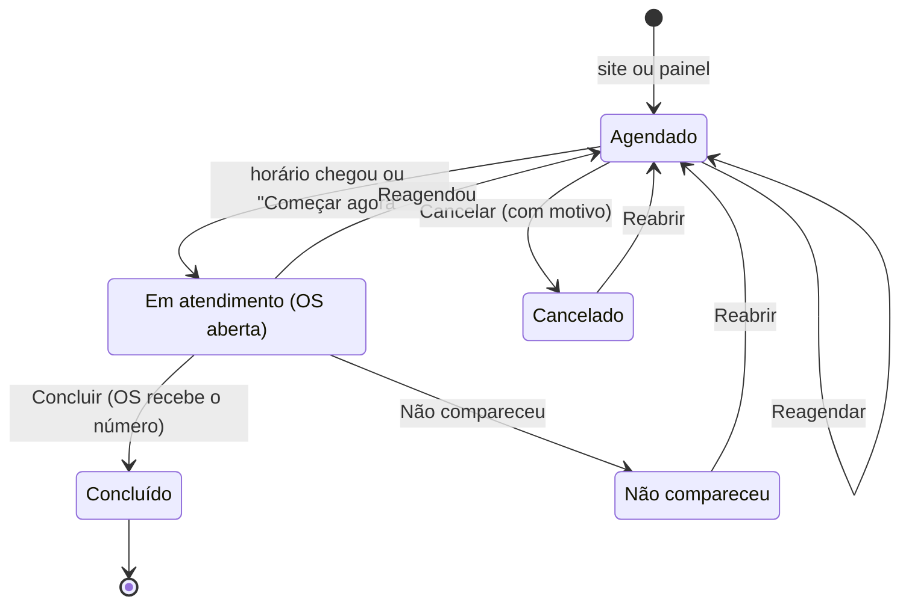
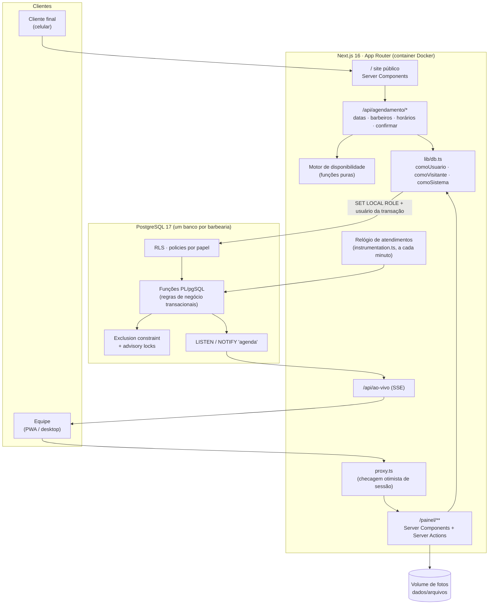

# 💈 Barbearia App: agendamento online e gestão de atendimento


Sistema completo para barbearias com duas partes no mesmo app:

- um **site público** em que o cliente agenda sem criar conta;
- um **painel da equipe** com agenda ao vivo, ordem de serviço, pagamentos divididos, descontos, histórico de clientes, financeiro e relatórios.

O mesmo código atende **qualquer barbearia**. Nome, logo, contatos, horários e serviços vêm do banco, nunca do código. Cada barbearia roda com o **próprio banco PostgreSQL**, isolado das demais.

<p align="center">
  <br>
  <em>Cliente agenda pelo site → o horário aparece na agenda do barbeiro → OS com pagamento dividido (Pix + dinheiro) é concluída e recebe o número. Dados fictícios.</em>
</p>

> **Destaques técnicos:** motor de disponibilidade em funções puras e testadas; **trava de sobreposição de horário no próprio banco** (*exclusion constraint* + *advisory locks*), que resolve a corrida entre dois clientes pelo mesmo horário; **RLS do PostgreSQL** como autoridade de permissão; login próprio com bcrypt e sessões com hash; agenda **em tempo real** via `LISTEN/NOTIFY` + SSE; e **contingência com segunda VPS**, em que o app detecta réplica e primário sozinho.

---

## Sumário

- [Funcionalidades](#funcionalidades)
- [Arquitetura](#arquitetura)
- [Tecnologias](#tecnologias)
- [Regras de negócio em destaque](#regras-de-negócio-em-destaque)
- [Segurança](#segurança)
- [Desempenho, escalabilidade e disponibilidade](#desempenho-escalabilidade-e-disponibilidade)
- [Desafios técnicos e soluções](#desafios-técnicos-e-soluções)
- [Qualidade e testes](#qualidade-e-testes)
- [Estrutura do projeto](#estrutura-do-projeto)
- [Como rodar](#como-rodar)
- [Documentação complementar](#documentação-complementar)
- [Melhorias futuras](#melhorias-futuras)

---

## Funcionalidades

### Site público (cliente final, sem login)

| Recurso | Como funciona |
|---|---|
| **Agendamento em uma página só** | Serviços (mais de um por vez) → data → profissional → horário (manhã/tarde/noite). Cada seção aparece conforme a escolha anterior. O resumo fica fixo no rodapé e o botão só habilita com tudo escolhido. |
| **Disponibilidade real** | Só aparecem dias, barbeiros e horários em que o atendimento **inteiro** cabe, considerando funcionamento, jornada, intervalos, folgas, feriados, antecedência mínima e agenda já ocupada. |
| **Status "Aberto / Fechado"** | Calculado pelo horário cadastrado menos feriados ("Fecha às 18:00", "Abre Sex às 09:00"). O relógio anda no navegador e o status muda sozinho na hora de abrir ou fechar. |
| **Identidade da barbearia** | Logo, endereço com link "Como chegar", mapa, Instagram, telefone e **botão flutuante de WhatsApp**, tudo vindo do cadastro. |
| **Dados lembrados no aparelho** | Nome e telefone ficam salvos no navegador para o próximo agendamento. |
| **Visual premium e acessível** | Paleta escura própria, títulos em Montserrat, animações curtas desligadas com "reduzir movimento", layout testado de 320 px a 1280 px. |

### Painel da equipe (login)

| Módulo | Recursos |
|---|---|
| **Início** | Hoje (atendimentos, previsto, recebido, a receber, cancelamentos, descontos), mês (faturamento, ticket médio, serviços mais realizados, valores pendentes) e próximos atendimentos. O barbeiro vê os próprios números. |
| **Agenda** | Visões **Dia** (grade horária com uma coluna por barbeiro, blocos na altura exata da duração, área fora do expediente hachurada, linha do "agora"), **Semana** e **Mês**. Filtros por barbeiro, status e serviço. Indicador **"Ao vivo"**. Tocar num horário livre abre o encaixe já preenchido. |
| **Agendamento** | Encaixe pelo balcão com sugestão de horários livres, reagendamento listando só os inícios livres, cancelamento com motivo, "Começar agora" para cliente adiantado e mensagens de WhatsApp prontas. |
| **Ordem de Serviço (OS)** | Abre **sozinha no horário marcado**. Serviços agendados × realizados, serviço adicional, desconto fixo ou percentual com motivo, **pagamento dividido** (dinheiro, Pix, débito, crédito, outros) com soma ao vivo, estorno lógico e conclusão com pagamento pendente ou parcial. Numeração **sem buracos**, atribuída só na conclusão. |
| **Clientes** | Busca sem acento por nome ou telefone, histórico com o valor cobrado em cada OS e **métricas de comportamento**: ticket médio, tempo médio de retorno, dias sem voltar e alerta "X dias além do habitual". |
| **Financeiro** | Filtros Hoje · Semana · Mês · Mês passado · Período (até ~400 dias) e por barbeiro. Faturamento, recebido (visão de caixa), pendente, ticket médio, formas de pagamento, serviços, desempenho por barbeiro, descontos por motivo, cancelamentos e não comparecimentos, e série por dia ou por mês. |
| **Configurações** (admin) | Dados e logo da barbearia, horários semanais com várias faixas por dia, regras de agendamento, feriados, serviços com foto, equipe (acessos, permissões, foto, jornada, folgas, serviços que realiza, ordem no site) e os **6 modelos de mensagem de WhatsApp** com prévia, validação de variáveis e "Restaurar texto padrão". |
| **PWA** | Instalável na tela inicial, com o logo cadastrado como ícone e "puxar para atualizar". |

### Ciclo de vida do agendamento



---

## Arquitetura



**Princípios que guiam o desenho:**

1. **O banco é a autoridade.** Permissões (RLS), integridade (constraints e triggers) e regras de negócio que mudam dinheiro ou agenda (funções transacionais, "tudo ou nada") vivem no PostgreSQL. A interface só reflete essas regras. Agendamentos e OS **não aceitam `INSERT`/`UPDATE` direto** de ninguém, nem do admin: tudo passa por funções que conferem dono, papel e transição de estado.
2. **O navegador nunca fala com o banco.** Todo acesso passa pelo servidor do Next.js, sempre numa transação com o papel certo: `authenticated` + usuário da sessão, `anon` para o site, ou `service_role` só depois de checar a permissão.
3. **Lógica crítica em funções puras.** Motor de disponibilidade, grade da agenda, status de funcionamento, métricas do cliente e rolagem contínua são módulos sem I/O, testados isoladamente.
4. **Multi-tenant por isolamento físico.** Um banco e um usuário por barbearia no mesmo servidor PostgreSQL. O banco de um cliente não aceita `CONNECT` de outros usuários.
5. **Snapshot de valores históricos.** Preço, nome e duração do serviço são **copiados** para o agendamento e para a OS. Mudar o catálogo nunca altera histórico nem relatórios.

O detalhamento, com as **49 decisões de arquitetura numeradas** citadas nos comentários do código, está em [`docs/ARQUITETURA.md`](docs/ARQUITETURA.md).

---

## Tecnologias

| Camada | Tecnologia | Uso no projeto |
|---|---|---|
| Framework | **Next.js 16.3** (App Router) | Server Components, Server Actions, Route Handlers, `proxy.ts` (antigo middleware), `instrumentation.ts`, manifesto PWA dinâmico |
| UI | **React 19.2**, **Tailwind CSS 4** | Tema por tokens (`@theme`), componentes próprios sem biblioteca de UI, `next/font` (Montserrat) |
| Linguagem | **TypeScript 5** (strict) | Tipos de domínio, parâmetros tipados nas consultas |
| Banco | **PostgreSQL 17** | RLS, PL/pgSQL, *exclusion constraint* com `btree_gist`, colunas geradas, `LISTEN/NOTIFY`, `pgcrypto` (bcrypt), `unaccent` |
| Acesso a dados | **postgres.js** | Pool por processo, *tagged templates* parametrizados (sem SQL concatenado), *parsers* de tipo customizados |
| Imagens | **sharp**, **browser-image-compression**, **heic2any** | Compressão no navegador, conversão de HEIC (iPhone) e detecção do formato pelos bytes no servidor |
| Infra | **Docker Compose**, Node 22 | Postgres + app em containers, portas só em `127.0.0.1`, build em múltiplos estágios, usuário sem privilégios |
| Qualidade | **ESLint 9** (config Next), `tsc --noEmit` | Lint e checagem de tipos limpos a cada entrega |

Sem bibliotecas de UI, de estado global nem ORM. A escolha deliberada foi depender pouco de terceiros e manter o SQL visível e auditável.

---

## Regras de negócio em destaque

<details>
<summary><b>Motor de disponibilidade</b> (<code>src/lib/agendamento/motor.ts</code>)</summary>

Um horário de início só é oferecido se o intervalo **meio-aberto** `[início, início + duração total)` couber inteiro:

- dentro do funcionamento da barbearia naquele dia, respeitando intervalos como o almoço;
- dentro da jornada do barbeiro;
- sem tocar feriado, folga, bloqueio ou outro agendamento ativo;
- respeitando a antecedência mínima e a janela máxima de dias;
- com um barbeiro que realiza **todos** os serviços escolhidos.

O cálculo é feito por interseção e subtração de listas de intervalos. Os candidatos andam na granularidade configurada (ex.: 15 min). Exemplo: barbeiro ocupado das 14:00 às 14:45 e serviço de 1 h, então **14:30 não é oferecido**. O motor tem dois modos: **site**, com antecedência e janela, e **painel**, que só sugere, porque a equipe pode encaixar fora da regra, mas nunca sobrepor.

Na confirmação, o servidor **recalcula** os horários e só aceita um que esteja na lista. A gravação é feita por uma única função transacional, `criar_agendamento()`: cliente + agendamento + serviços, tudo ou nada.
</details>

<details>
<summary><b>Ordem de Serviço e dinheiro</b></summary>

- **Agendamento ≠ OS.** O agendamento é o que foi marcado. A OS é o que de fato aconteceu: serviços realizados, adicionais, desconto e pagamentos.
- Subtotal, desconto calculado, total, total pago e status do pagamento (`pendente | parcial | pago`) são **calculados pelo banco** (colunas geradas e triggers), nunca digitados.
- Pagamento nunca passa do restante. O total nunca fica abaixo do já pago (é preciso estornar antes). O estorno é **lógico** e fica no histórico.
- **Pagamento dividido** em várias formas numa única chamada (`registrar_pagamentos(os, jsonb)`), tudo ou nada.
- O desconto pode ser aplicado pelo barbeiro nas próprias OS, sempre com tipo, valor e motivo (fidelidade, promoção, cortesia, cupom, personalizado), e aparece nos relatórios.
- **Numeração da OS sem buracos:** o número só é atribuído na conclusão, a partir de um contador atualizado na mesma transação. Se a conclusão falha, nenhum número é gasto, ao contrário de uma `sequence`.
</details>

<details>
<summary><b>Financeiro com fórmulas únicas</b></summary>

Todos os números saem de uma só função, `relatorio_financeiro(de, ate, barbeiro)`, com `SECURITY INVOKER`. A própria RLS faz o barbeiro receber só os próprios números e o admin tudo, **sem duplicar regra de permissão**. As definições ficam no código e na documentação:

- **Faturamento**: total (já com desconto) das OS concluídas, pela data do atendimento.
- **Recebido**: pagamentos não estornados no período (visão de caixa).
- **Pendente**: total menos pago das OS concluídas no período.
- **Ticket médio**: faturamento ÷ atendimentos.
- **Previsto**: o agendamento que já virou OS conta no dia do atendimento, e não no dia marcado.
</details>

<details>
<summary><b>Atendimento automático</b></summary>

Um "relógio" no servidor, registrado em `instrumentation.ts`, roda a cada minuto e chama `iniciar_atendimentos_do_horario()`. Todo agendamento cujo horário chegou vira atendimento com a OS aberta. Concluir antes do previsto **encurta o bloco na agenda** e libera o resto do horário para novos agendamentos. Duas instâncias rodando ao mesmo tempo (cenário de contingência) não se atrapalham, graças ao `FOR UPDATE SKIP LOCKED`.
</details>

<details>
<summary><b>Mensagens de WhatsApp</b></summary>

Seis modelos fixos (confirmar agendamento, lembrete, agendamento confirmado, atendimento concluído, reagendamento, cancelamento), com texto editável pelo admin e variáveis `{cliente}`, `{barbearia}`, `{data}`, `{hora}`, `{barbeiro}`, `{servicos}`, `{valor}`, `{endereco}` e `{site}`. Os botões abrem o `wa.me` com a mensagem pronta, sem API paga nem biblioteca não oficial. Variável desconhecida é recusada ao salvar. Dado não cadastrado some do texto em vez de chegar cru ao cliente.
</details>

---

## Segurança

| Ameaça ou risco | Mitigação implementada |
|---|---|
| Acesso indevido a dados | **RLS em todas as tabelas**. `is_admin()` é o único ponto que checa papel. O barbeiro vê a ocupação da equipe, mas cliente, telefone, valor e observação **só dos próprios** atendimentos (view `agenda_equipe` com mascaramento por coluna). |
| Escalada de privilégio | Funções sensíveis com `REVOKE EXECUTE` para `anon`/`authenticated`. O barbeiro não altera o próprio papel nem a própria ordem no site (policy). Toda mudança de agenda ou OS passa por função que confere dono e transição. |
| Senhas | **bcrypt** conferido no banco (`pgcrypto`). E-mail inexistente também passa por um bcrypt, para não denunciar pelo tempo de resposta quais contas existem. |
| Sessões | Token aleatório de 32 bytes em cookie `httpOnly` + `SameSite=Lax` (`secure` sob HTTPS). O banco guarda **só o SHA-256** do token. Desativar o usuário ou trocar a senha derruba as sessões. |
| Força bruta | 5 falhas por e-mail **ou** 20 por IP em 15 min bloqueiam o login. O agendamento público tem limite de **10 confirmações por IP por hora** e de **3 agendamentos futuros por telefone** (serializado no banco). |
| IP forjado | IP lido de `X-Real-IP` (sobrescrito pelo Nginx) ou do **último** item do `X-Forwarded-For`, nunca do primeiro, que o visitante controla. `CF-Connecting-IP` só é aceito com uma flag explícita, quando o firewall aceita apenas o Cloudflare. |
| Sequestro de cadastro | O site **nunca renomeia** um cliente existente. Quem digita o telefone de outra pessoa não troca o nome dela. |
| SQL injection | Todas as consultas usam *tagged templates* parametrizados. |
| Upload malicioso | Envio só por admin, **formato detectado pelos bytes** (não pela extensão), limite de 5 MB e nome gerado pelo servidor (UUID). |
| Exposição de infraestrutura | Postgres e app publicados só em `127.0.0.1`. O usuário do app no banco é `NOINHERIT`, sem permissão própria (só lê via `SET ROLE`). O container roda com usuário sem privilégios. |

---

## Desempenho, escalabilidade e disponibilidade

- **Índices nos acessos frequentes:** agenda por barbeiro e horário, histórico do cliente, OS por status e data, pagamentos não estornados por data (índice parcial), OS concluídas para relatórios (índice parcial), sessões e tentativas de login.
- **Pool de conexões** por processo, reaproveitado entre recarregamentos em desenvolvimento.
- **Ao vivo sem polling pesado:** `NOTIFY` sem dados (só "algo mudou") e uma única conexão `LISTEN` por processo, repassada a todas as telas abertas por SSE. A tela recarrega pelo caminho normal, então **a RLS continua decidindo o que cada um vê**. Há uma checagem a cada 30 s como rede de segurança.
- **Escala horizontal por cliente:** cada barbearia é um container e um banco. Adicionar um cliente é criar um banco e um usuário (o `db:migrar` faz isso de forma idempotente).
- **Contingência com segunda VPS:** o endpoint `/api/saude` responde `200 {banco: "principal" | "replica"}` ou `503` em até 5 s. Na VPS secundária, o app usa o banco da principal (pela VPN) enquanto o local for réplica. Quando o local é promovido, o app **fica preso nele** até reiniciar, para não voltar a um primário com dados velhos. O relógio de atendimentos nunca grava numa réplica.

---

## Desafios técnicos e soluções

| Desafio | Solução |
|---|---|
| **Dois clientes confirmando o mesmo horário ao mesmo tempo** | *Exclusion constraint* `EXCLUDE USING gist (barbeiro_id WITH =, tstzrange(inicio, fim, '[)') WITH &&)`, que ignora cancelados. Sob concorrência, duas gravações sobrepostas causavam **deadlock (40P01) → erro 500**. Um gatilho com `pg_advisory_xact_lock` por barbeiro (em ordem fixa quando o barbeiro muda) serializa as gravações: o segundo espera e recebe o `23P01` normal, traduzido em "Esse horário acabou de ser reservado" (HTTP 409). O teste reproduziu o 500 antes da correção e passou depois em 54 corridas simultâneas. |
| **Sair do Supabase sem reescrever as regras de segurança** | Uma camada de compatibilidade (`db/compat.sql`) recria no PostgreSQL puro o que as migrations esperam: papéis `anon`/`authenticated`/`service_role`, `auth.users` e `auth.uid()` lendo o usuário da transação. **As migrations entraram sem alteração.** A cópia dos dados preservou as senhas (os hashes já eram bcrypt) e foi conferida por md5 de todas as tabelas. |
| **Fuso horário** (servidor em UTC, negócio em São Paulo) | Fuso fixo `America/Sao_Paulo`. O banco guarda `timestamptz`, horas de parede em `time`, e toda conversão passa por um único módulo (`lib/datas.ts`), testado na virada de dia, de ano e em ano bissexto. |
| **Grade da agenda no celular** prendendo o gesto de rolagem | Rolagem contínua: no limite da grade, o mesmo gesto passa a rolar a página, com inércia. A regra pura está em `lib/rolagem-continua.ts`, com testes. |
| **Código de erro do Postgres perdido no bundle** | O Next pode empacotar a biblioteca em duas cópias e aí o `instanceof PostgresError` falha. Ler `erro.code` resolveu o "409 que virava 500". |
| **Build sem segredos** | O build do Docker roda sem a URL do banco. Páginas públicas usam `await connection()` para nunca serem pré-renderizadas com preços congelados do dia do build. |
| **`jsonb` como parâmetro** | Passar `tx.json(objeto)`, porque texto com `::jsonb` chegava como *string* JSON e quebrava jornada, horários e pagamento dividido. Os testes pegaram o problema antes de chegar ao usuário. |

---

## Qualidade e testes

O projeto foi construído **em fases**, e cada fase só foi marcada como concluída depois de testada rodando no Docker.

- **Testes unitários** (Node com `--experimental-strip-types`): motor de disponibilidade, grade da agenda, status de funcionamento, métricas do cliente, rolagem contínua e leitura de IP.
- **Testes de integração e ponta a ponta** (`scripts/testes/*.mjs`), contra o app e o banco reais: permissões por papel (admin, barbeiro, visitante), corrida de horário, fluxo site → agenda → OS → pagamento dividido → financeiro, login e sessões, upload, eventos ao vivo, fluxo automático e endpoint de saúde. A última bateria completa registrada somou **mais de 460 verificações**. Cada teste cria usuários e dados temporários e **apaga tudo no final**.
- `eslint` e `tsc --noEmit` limpos.

```bash
node --experimental-strip-types scripts/testes/motor.mts   # unitário
node scripts/testes/ponta-a-ponta.mjs                      # integração (app + banco no ar)
```

---

## Estrutura do projeto

```
barbearia-app/
├── db/
│   ├── compat.sql               # papéis, auth.users, auth.uid() no Postgres puro
│   └── migrations/              # 18 migrations SQL versionadas (tabelas, RLS, funções)
├── scripts/
│   ├── db-migrar.mjs            # cria banco/usuário do cliente e aplica migrations (idempotente)
│   ├── copiar-banco.mjs         # cópia banco → banco (migração para a VPS)
│   ├── dados-exemplo.mjs        # dados fictícios para desenvolvimento
│   └── testes/                  # unitários (.mts) e integração/ponta a ponta (.mjs)
├── src/
│   ├── app/
│   │   ├── page.tsx             # site público
│   │   ├── _site/               # reserva em uma página, status aberto/fechado, visual
│   │   ├── api/
│   │   │   ├── agendamento/     # datas · barbeiros · horários · confirmar
│   │   │   ├── ao-vivo/         # SSE
│   │   │   ├── arquivos/        # upload de imagens (admin)
│   │   │   └── saude/           # health check para a contingência
│   │   ├── login/ · sair/
│   │   └── painel/              # início, agenda, atendimentos (OS), clientes,
│   │                            # financeiro, configurações
│   ├── components/              # números/indicadores, ao vivo, editor semanal, etc.
│   ├── lib/
│   │   ├── agendamento/         # motor, disponibilidade, catálogo, limite, status
│   │   ├── auth/                # sessão, cookie, perfil
│   │   ├── clientes/            # métricas, telefone
│   │   ├── mensagens/           # modelos e links wa.me
│   │   ├── db.ts                # acesso ao banco por papel + contingência
│   │   ├── ao-vivo.ts           # LISTEN/NOTIFY
│   │   └── datas.ts             # fuso de São Paulo
│   ├── instrumentation.ts       # relógio de atendimentos
│   └── proxy.ts                 # proteção de rota do painel
├── Dockerfile
└── docker-compose.yml
```

Rotas: `/` site e agendamento · `/login` · `/painel/**` área da equipe.

---

## Como rodar

**Pré-requisitos:** Docker com Compose e Node.js 22+.

```bash
# 1. Variáveis de ambiente (senhas locais à sua escolha)
cp .env.example .env.local

# 2. Dependências
npm ci

# 3. Banco PostgreSQL local em 127.0.0.1:5433
docker compose --env-file .env.local up -d db

# 4. Cria o banco e o usuário do app e aplica compat + migrations
npm run db:migrar

# 5. App em http://127.0.0.1:3002
docker compose --env-file .env.local up -d --build app
```

**Primeiro acesso.** O primeiro usuário criado vira administrador (gatilho `handle_new_user`). Para criá-lo direto no banco:

```sql
-- conectado ao banco "barbearia" como superusuário
insert into auth.users (email, encrypted_password, raw_user_meta_data)
values ('admin@exemplo.com', extensions.crypt('troque-esta-senha', extensions.gen_salt('bf', 10)), '{"nome": "Admin"}');
```

Depois, entre em `/login` e cadastre a barbearia em **Configurações**. Os demais usuários são criados pela própria tela de Equipe. Opcionalmente, `node scripts/dados-exemplo.mjs` popula serviços, barbeiros e agendamentos fictícios (`--remover` desfaz).

**Produção.** O mesmo `docker-compose.yml` roda na VPS, atrás de Nginx com HTTPS repassando `X-Real-IP`, `X-Forwarded-For` e `X-Forwarded-Proto`. Os dados migram com `scripts/copiar-banco.mjs`. O passo a passo está em [`docs/ARQUITETURA.md`](docs/ARQUITETURA.md#implantação-em-vps).

---

## Documentação complementar

| Documento | Conteúdo |
|---|---|
| [`docs/ARQUITETURA.md`](docs/ARQUITETURA.md) | Registro das 49 decisões de arquitetura, contingência, implantação e aprendizados técnicos |
| [`docs/BANCO-DE-DADOS.md`](docs/BANCO-DE-DADOS.md) | Modelo de dados (diagrama ER), funções, views, travas e políticas de acesso |

---

## Melhorias futuras

Não implementado hoje. Fica registrado como evolução natural:

- **Comissão por barbeiro:** a estrutura já existe no banco (modo e valor por barbeiro e por serviço, com snapshot nos itens da OS), faltam telas e cálculo.
- **"Não tenho preferência" de barbeiro** no site: o motor foi escrito para facilitar essa opção.
- **Backup automatizado** (`pg_dump` agendado + cópia das fotos fora do servidor) e monitoramento.
- **Limite de tentativas distribuído** (hoje o limite por IP do agendamento fica em memória, suficiente para um container por barbearia).
- **Cor de destaque e foto de capa configuráveis** por barbearia.
- **CI** (GitHub Actions) rodando lint, tipos e a bateria de testes num Postgres efêmero.
- **Emissão de NFS-e** via plataforma intermediária, se algum cliente precisar.
- Limpeza de imagens órfãs (enviadas e não salvas).

---

## Licença

Código publicado para fins de portfólio. Todos os direitos reservados.
