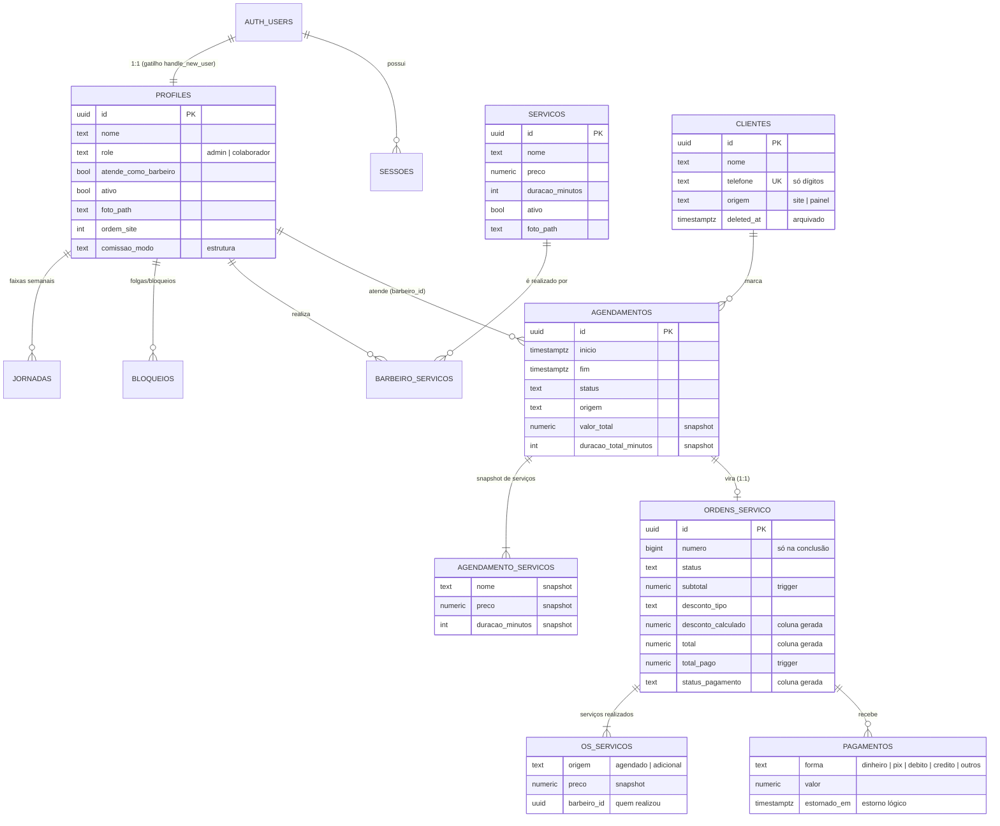

# Modelo de dados

O banco é **PostgreSQL 17**, versionado por migrations SQL em `db/migrations/` e aplicado por `npm run db:migrar`. A aplicação é idempotente e cada arquivo roda numa transação, anotado em `migracoes.aplicadas`. A fonte da verdade são as migrations, e este documento é um índice legível delas.

**Números:** 18 migrations · ~2.500 linhas de SQL · 18 tabelas de aplicação/autenticação · 4 views · mais de 35 funções PL/pgSQL · 14 triggers · 32 policies de RLS.

---

## Diagrama entidade-relacionamento

Tabelas de configuração, independentes do diagrama: `estabelecimento` (linha única com marca, contatos e regras de agendamento), `horarios_funcionamento` (faixas semanais), `mensagens_templates` (6 tipos fixos, com texto padrão guardado), `contador_os` (numeração sem buracos) e `auth.tentativas_login` (limite de tentativas).

---

## Tabelas

| Tabela | Papel no domínio |
|---|---|
| `auth.users` | Usuários do login próprio: e-mail minúsculo e único, senha bcrypt, `banned_until` para desativação. Equipe e visitantes não acessam esta tabela. |
| `auth.sessoes` | Sessões: só o **SHA-256** do token, expiração, "permanecer conectado", último uso e user agent. |
| `auth.tentativas_login` | Falhas de login por chave (`email:…` e `ip:…`) para a janela de 15 min. |
| `profiles` | Perfil da equipe: papel, "atende como barbeiro", foto, ordem no site e estrutura de comissão. Nasce por gatilho a partir de `auth.users`, e o **primeiro usuário vira admin** (com *advisory lock* para não haver dois "primeiros"). |
| `estabelecimento` | Marca e regras da barbearia: antecedência mínima, janela de dias, granularidade dos horários e política de cancelamento. Leitura pública, escrita só do admin. |
| `horarios_funcionamento`, `jornadas` | Faixas semanais (várias por dia = intervalo), trocadas em bloco por funções que validam sobreposição. |
| `bloqueios` | Feriado (barbearia inteira, `profile_id` nulo), folga ou bloqueio de um barbeiro. |
| `servicos`, `barbeiro_servicos` | Catálogo e quem realiza o quê. |
| `clientes` | Telefone único normalizado, origem site ou painel e arquivamento lógico. |
| `agendamentos`, `agendamento_servicos` | O que foi marcado, com snapshot de nome, preço e duração. **Nunca apagados**: são cancelados. |
| `ordens_servico`, `os_servicos`, `pagamentos` | O que aconteceu: serviços realizados, desconto, pagamentos com estorno lógico e totais calculados pelo banco. |
| `mensagens_templates` | Modelos de WhatsApp: `conteudo` editável e `conteudo_padrao` imutável. |
| `contador_os` | Último número de OS, atualizado na transação da conclusão. |

---

## Integridade garantida pelo banco

| Garantia | Mecanismo |
|---|---|
| Um barbeiro nunca tem dois agendamentos ativos sobrepostos | `EXCLUDE USING gist (barbeiro_id WITH =, tstzrange(inicio, fim, '[)') WITH &&) WHERE status NOT IN ('cancelado','nao_compareceu')` (extensão `btree_gist`) |
| Corrida pelo mesmo horário não vira deadlock | Gatilho `agendamentos_fila_por_barbeiro` com `pg_advisory_xact_lock` por barbeiro, em ordem fixa |
| No máximo 3 agendamentos futuros por telefone | Checagem em `criar_agendamento()`, serializada por `pg_advisory_xact_lock` no telefone |
| Totais da OS sempre consistentes | `desconto_calculado`, `total` e `status_pagamento` como **colunas geradas**; `subtotal` e `total_pago` recalculados por triggers |
| Pagamento não ultrapassa o restante | Validação em `registrar_pagamento()` (erro `PAGAMENTO_ACIMA_DO_RESTANTE`) |
| Total não fica abaixo do já pago | Constraint `ordens_servico_pago_ate_o_total` |
| Faixas de horário válidas | `validar_faixas_semana()`: início < fim e sem sobreposição, tudo ou nada |
| Início antes do fim | `CHECK (inicio < fim)` |
| `updated_at` sempre correto | Gatilho `set_updated_at` |

---

## Funções principais (regras de negócio transacionais)

| Grupo | Funções |
|---|---|
| Autorização | `is_admin()`, `auth.uid()`, `pode_gerenciar_agendamento()` |
| Cadastros | `substituir_horarios_funcionamento()`, `substituir_jornada()`, `definir_servicos_barbeiro()`, `atribuir_servico_a_todos()` |
| Agendamento | `criar_agendamento()` (site; **sem `EXECUTE` para anon ou authenticated**), `criar_agendamento_painel()`, `alterar_status_agendamento()`, `reagendar_agendamento()`, `comecar_agora()` |
| OS | `iniciar_atendimento()`, `iniciar_atendimentos_do_horario()` (relógio, `FOR UPDATE SKIP LOCKED`), `adicionar_servico_os()`, `remover_servico_os()`, `aplicar_desconto_os()`, `registrar_pagamento()`, `registrar_pagamentos(jsonb)`, `estornar_pagamento()`, `concluir_atendimento()`, `reabrir_atendimento()`, `cancelar_atendimento()`, `desfazer_os()` |
| Números | `relatorio_financeiro(de, ate, barbeiro)` (`SECURITY INVOKER`: a RLS recorta por barbeiro) |
| Utilidades | `sem_acento()` (busca com `unaccent`), `avisar_mudanca_agenda()` (`pg_notify('agenda', '')`) |

As funções levantam mensagens de erro em português ("Horário ocupado…", "Apenas administradores…"), que a interface exibe direto. Códigos SQLSTATE conhecidos (`23P01`, `40P01`, `23505`) são traduzidos em respostas específicas, como o HTTP 409 para horário disputado.

---

## Views

| View | Finalidade |
|---|---|
| `agenda_equipe` | Todos os agendamentos para qualquer usuário logado, com **mascaramento por coluna**: cliente, telefone, valor e observação só aparecem para o dono do atendimento ou para o admin. |
| `clientes_resumo` | Primeiro e último atendimento, quantidade (só concluídos) e próximo agendamento por cliente, respeitando a RLS de quem consulta. |

---

## Segurança no banco

- **RLS habilitada em todas as tabelas de `public`.** Padrão *own-or-admin*: o barbeiro acessa o que é dele, e o admin acessa tudo via `is_admin()`, único ponto que checa papel.
- **Sem policies de INSERT/UPDATE** em agendamentos e OS: toda escrita passa pelas funções acima, que conferem dono, papel e transição de estado.
- **Sem exclusão física** de cliente, usuário, agendamento ou OS: arquivar, desativar e cancelar preservam histórico e auditoria.
- **Papéis no estilo Supabase recriados no Postgres puro** (`db/compat.sql`): `anon`, `authenticated` e `service_role` (`BYPASSRLS`). O usuário de conexão do app é `NOINHERIT` e só ganha poderes via `SET LOCAL ROLE` dentro de cada transação, com o usuário da sessão em `request.jwt.claim.sub`. Os testes confirmam que **sem `SET ROLE` nada é lido** e que `auth.uid()` não vaza entre transações.
- **Isolamento entre clientes:** o banco de cada barbearia não aceita `CONNECT` público, só do seu próprio usuário.
